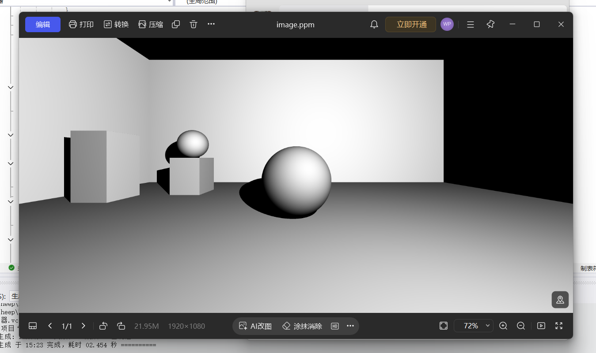

# CPU Raytracer (软光追渲染器)

一个从零手写的基于 C++ 的 CPU 光线追踪渲染器。

## 核心特性 (Features)
- **面向对象架构**：使用 C++ 多态（基类与虚函数）统一管理球体、平面与立方体（Box）。
- **BVH 加速**：实现 AABB 包围盒与二叉树加速结构，大幅降低光线求交复杂度。
- **SSAA 抗锯齿**：采用超采样（Super Sampling）技术，消除物体边缘锯齿。
- **硬阴影**：通过发射 Shadow Ray 实现精确的光线遮挡计算。

## 渲染展示 (Render Showcase)

